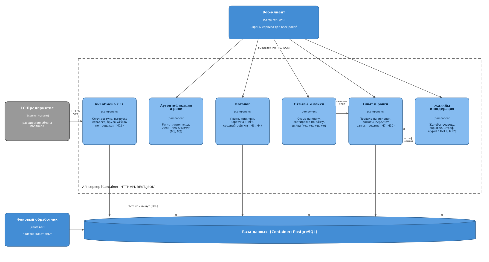

# C4 Component Diagram — КнигоПоиск

| **Поле** | **Описание** |
| --- | --- |
| Документ | C4, уровень 3: компоненты контейнера «API-сервер» (Практика 6) |
| Версия | v1.0 |
| Дата | 16.11.26 |
| Основа | [C4Container.md](C4Container.md), [WorkPackages.md](WorkPackages.md), [ProjectCard.md](ProjectCard.md) (раздел 5.16) |

## 1. Почему раскрыт API-сервер

API-сервер — самый трудоёмкий пакет работ (44 ч из 164 по укрупнённой оценке) и единственный контейнер, через который проходят все требования Must: в нём живут правила опыта, модерации и обмена с 1С.

## 2. Диаграмма

**Легенда:** голубые — компоненты API-сервера; синие — другие контейнеры КнигоПоиска; серый — внешняя система.

## 3. Компоненты

| Компонент | Ответственность | Вызывает | Требования | Задачи |
| --- | --- | --- | --- | --- |
| API обмена с 1С | Проверка ключа доступа партнёра, выгрузка каталога со статистикой отзывов (`AvgRating`, `ReviewsCount`), приём и проверка отчёта по продажам в `sales_reports` | БД | M13 | З-17 |
| Аутентификация и роли | Регистрация, вход, хэширование пароля, сессии, проверка роли для каждого запроса, управление пользователями и порогами рангов (UC-10) | БД | M1, M2 | З-04, З-16 |
| Каталог | Поиск и фильтры (жанр, автор, год), карточка книги, средний рейтинг по активным отзывам | БД | M3, M4 | З-05 |
| Отзывы и лайки | Отзыв (один на книгу от пользователя), редактирование и удаление, сортировка по рангу автора и дате, лайки с запретом на свой отзыв | Опыт и ранги, БД | M5, M6, M8, M9 | З-14 |
| Опыт и ранги | Единые правила начисления из раздела 5.16 карточки: записи `pending` для отзывов, немедленные +2 XP за лайк, лимиты 100 и 10 XP в сутки, пересчёт ранга, данные профиля и страницы правил рангов | БД | M7, M10 | З-06 |
| Жалобы и модерация | Жалоба (причина + комментарий), автоприоритет при ≥ 3 жалобах от разных пользователей, очередь, скрытие, восстановление и удаление, штраф, `moderation_log` | Опыт и ранги, БД | M11, M12 | З-15 |

Правила начисления собраны в одном компоненте «Опыт и ранги», как решено в [ADR-0001](adr/ADR-0001-experience-worker.md). Фоновый обработчик подтверждает записи `pending` по тем же правилам.

## 4. Связи

| Откуда | Куда | Что передаётся | Протокол |
| --- | --- | --- | --- |
| Веб-клиент | Аутентификация и роли, Каталог, Отзывы и лайки, Опыт и ранги, Жалобы и модерация | Запросы пользователей всех ролей | HTTPS, JSON |
| 1С:Предприятие партнёра | API обмена с 1С | Запрос каталога, отчёт по продажам | HTTPS, REST/JSON, ключ доступа |
| Отзывы и лайки | Опыт и ранги | Создание записи опыта за отзыв (`pending`) и за лайк (`confirmed`), списание при снятии лайка | Вызов внутри процесса |
| Жалобы и модерация | Опыт и ранги | Штраф, отмена неподтверждённого опыта за скрытый отзыв | Вызов внутри процесса |
| Все компоненты | База данных | Чтение и запись своих таблиц | SQL |
| Фоновый обработчик | База данных | Подтверждение опыта, пересчёт рангов | SQL, раз в час |
