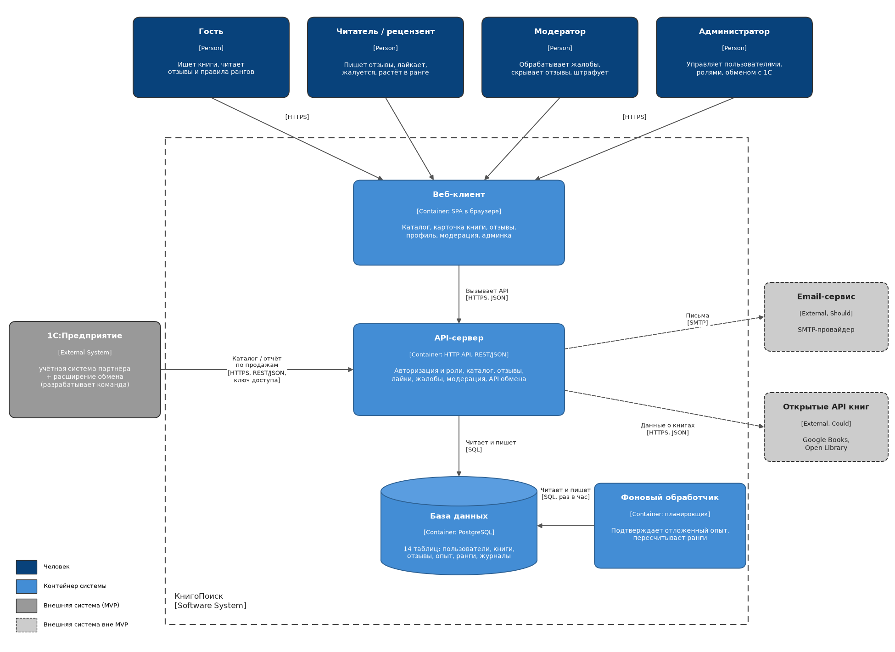

# C4 Container Diagram — КнигоПоиск

| **Поле** | **Описание** |
| --- | --- |
| Документ | C4, уровень 2: контейнеры (Практика 5) |
| Версия | v1.0 |
| Дата | 16.11.26 |
| Основа | [C4Context.md](C4Context.md), [UseCases.md](UseCases.md), [ProjectCard.md](ProjectCard.md) (модель данных) |

## 1. Диаграмма

**Легенда:** тёмно-синие — люди; синие — контейнеры системы; серые — внешние системы. Светло-серые с пунктиром — внешние системы вне MVP (Should/Could), пунктирные стрелки — связи с ними.

## 2. Контейнеры

| Контейнер | Технология | Ответственность | Use Case | Требования |
| --- | --- | --- | --- | --- |
| Веб-клиент | SPA в браузере (фреймворк — ADR-0002) | Все экраны: вход, каталог, карточка книги, отзывы, лайки, жалобы, профиль, правила рангов, очередь модерации, управление пользователями | UC-01 – UC-06, UC-09, UC-10 | M1, M3–M6, M8–M12 |
| API-сервер | HTTP API, REST/JSON (язык — ADR-0002) | Бизнес-правила: авторизация и роли, каталог, отзывы, лайки с немедленным начислением опыта, жалобы с автоприоритетом, модерация со штрафами, API обмена с 1С | UC-01 – UC-06, UC-08, UC-10 | M1–M9, M11–M13 |
| Фоновый обработчик | Отдельный процесс, запуск раз в час | Подтверждает отложенный опыт (`pending` → `confirmed`), применяет суточный лимит, отменяет опыт за скрытые отзывы, пересчитывает ранги | UC-07 | M7 |
| База данных | PostgreSQL | 14 таблиц из раздела 5 карточки проекта, ограничения целостности, индексы | все | M2, M3, M7, M10 |

Почему подтверждение опыта вынесено в отдельный контейнер, а не сделано внутри API, описано в [ADR-0001](adr/ADR-0001-experience-worker.md).

## 3. Внешние системы и связи

| Связь | Направление | Протокол | Приоритет |
| --- | --- | --- | --- |
| Люди → Веб-клиент | Работа с сервисом в браузере | HTTPS | Must |
| Веб-клиент → API-сервер | Все операции пользователя | HTTPS, JSON | Must |
| API-сервер → База данных | Чтение и запись данных | SQL | Must |
| Фоновый обработчик → База данных | Подтверждение опыта, пересчёт рангов | SQL, раз в час | Must |
| 1С:Предприятие партнёра → API-сервер | Запрос каталога со статистикой отзывов, отправка отчёта по продажам | HTTPS, REST/JSON, ключ доступа | Must |
| API-сервер → Email-сервис | Письма подтверждения и восстановления пароля | SMTP/TLS | Should |
| API-сервер → Открытые API книг | Данные о книгах для каталога | HTTPS, JSON | Could |

**Расширение обмена в 1С.** Обмен инициирует 1С (UC-08), поэтому на стороне партнёра нужно расширение конфигурации: HTTP-клиент и регламентное задание. Его разрабатывает 1C-Developer команды, но работает оно внутри 1С партнёра, поэтому на диаграмме показано как часть внешней системы, а не как контейнер КнигоПоиска. В плане работ это отдельный пакет 5.
