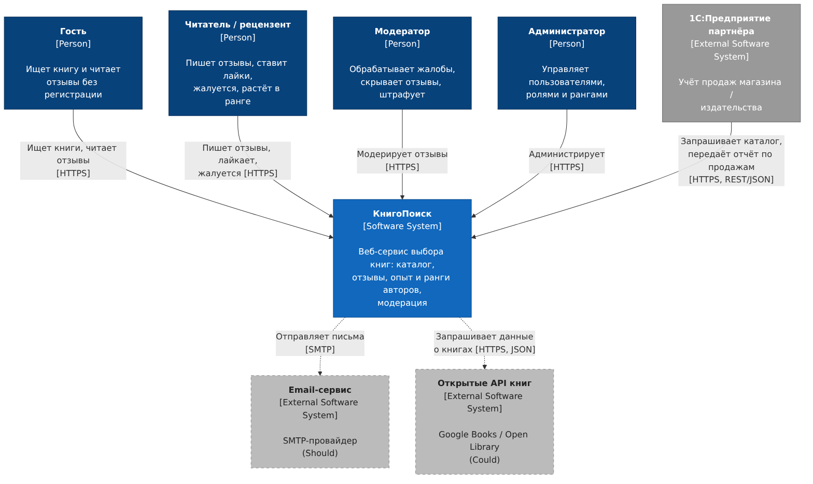
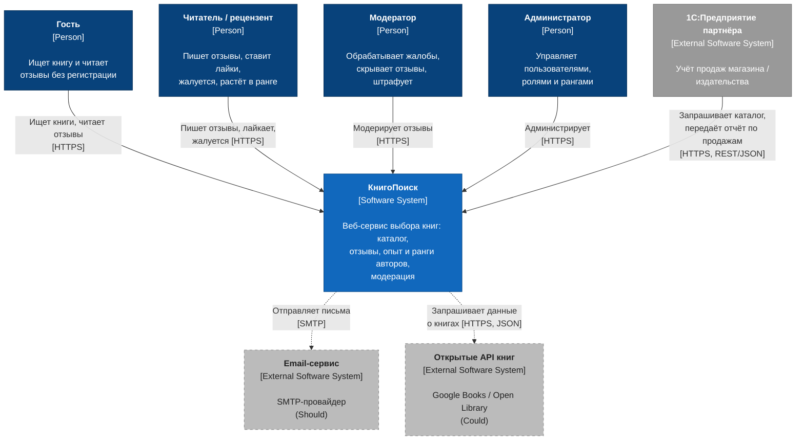

# C4 Context Diagram — КнигоПоиск

| **Поле**  | **Описание** |
| --------- | ------------ |
| Документ  | C4, уровень 1: системный контекст (Практика 4) |
| Версия    | v1.0 |
| Дата      | 20.10.26 |
| Основа    | [Vision.md](Vision.md) (границы), [UseCases.md](UseCases.md) (акторы) |

# 1. Диаграмма

Исходник диаграммы (Mermaid, нотация C4)

**Легенда:** тёмно-синие — люди (Person); синий — проектируемая система; серые — внешние системы. Светло-серые с пунктиром — внешние системы вне MVP (Should/Could), пунктирные стрелки — связи с ними.

# 2. Элементы диаграммы

| Элемент | Тип C4 | Описание | Связь с системой | Протокол |
| ------- | ------ | -------- | ---------------- | -------- |
| Гость | Person | Незарегистрированный посетитель (сегмент А) | Ищет книги, читает отзывы, смотрит правила рангов | HTTPS (браузер) |
| Читатель / рецензент | Person | Зарегистрированный пользователь (сегменты А и Б) | Пишет отзывы, лайкает, жалуется, смотрит профиль | HTTPS (браузер) |
| Модератор | Person | Сотрудник площадки | Обрабатывает очередь жалоб, применяет действия модерации | HTTPS (браузер) |
| Администратор | Person | Сотрудник площадки | Управляет пользователями, ролями, рангами, запускает обмен с 1С | HTTPS (браузер) |
| **КнигоПоиск** | Software System | Проектируемая система | — | — |
| 1С:Предприятие партнёра | External System | Учётная система магазина или издательства (сегмент В) | Забирает каталог со статистикой отзывов, передаёт отчёт по продажам | HTTPS, REST/JSON, ключ доступа |
| Email-сервис | External System (Should) | Внешний SMTP-провайдер | Получает письма для отправки (подтверждение, восстановление пароля) | SMTP/TLS |
| Открытые API книг | External System (Could) | Google Books, Open Library | Отдаёт данные о книгах для наполнения каталога | HTTPS, JSON |

# 3. Что осознанно не показано

- **Планировщик (A5)** — это внутренний компонент системы, а не внешний участник. На уровне Context его не видно, он появится на диаграмме C4 Container.
- **Платёжные системы и магазины-витрины** — продажа книг вне границ системы (Won't have).
- **Мобильные приложения** — вне границ (Won't have).

# 4. Проверка соответствия

| Проверка | Результат |
| -------- | --------- |
| Все люди-акторы A1–A4 из [UseCases.md](UseCases.md) есть на диаграмме | ✓ |
| Все внешние системы A6–A8 из [UseCases.md](UseCases.md) есть на диаграмме | ✓ |
| Внешние системы совпадают с разделом 5.3 [Vision.md](Vision.md) | ✓ |
| На диаграмме нет элементов из «Не входит в границы» | ✓ |
| У каждой связи есть подпись и протокол | ✓ |
